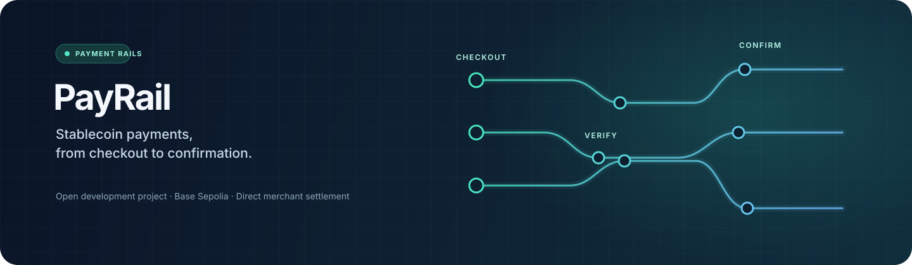
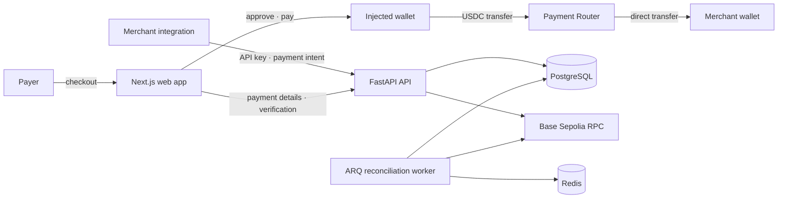

<div align="center">
  

  <h1>PayRail</h1>
  <p><strong>Stablecoin payments, from checkout to confirmation.</strong></p>
  <p>A development-stage payment infrastructure project built around direct USDC transfers, merchant payment intents, and on-chain receipt verification.</p>

  <p>
    
    
    
    
    
    
  </p>
</div>

> **Development project — not ready for production funds.** The checkout and reconciliation flow is designed for Base Sepolia and requires an operator-configured router deployment. This repository has not deployed a contract or submitted a blockchain transaction. The code has not received an independent security review.

## What is PayRail?

PayRail is an early-stage monorepo for exploring a complete stablecoin payment path:

1. A merchant creates a payment intent through the API.
2. A customer opens a hosted checkout and connects an injected wallet.
3. The wallet approves and sends the exact USDC amount directly to the merchant through the Payment Router.
4. The API checks the transaction receipt and router event; a background worker revisits pending receipts and checks their canonical block.

The router does not custody payment funds. PostgreSQL stores merchant and payment state; Redis supports the ARQ worker. The worker can notice some reorgs after the fact, but it cannot undo a merchant's fulfillment decision.

## How the pieces fit



The application currently targets **Base Sepolia** and a configured USDC-compatible token. Local contract tests use a mintable mock ERC-20; they do not contact a live network.

## What's implemented

| Area                 | Current state                                                                                                                                       |
| -------------------- | --------------------------------------------------------------------------------------------------------------------------------------------------- |
| Merchant API         | Development API-key registration; merchant-scoped payment intents, idempotent creation, retrieval, listing, and cancellation                        |
| Checkout             | Hosted injected-wallet flow with network selection, balance/allowance checks, approval, payment submission, and API verification polling            |
| Payment Router       | Solidity router using OpenZeppelin `SafeERC20`; direct payer-to-merchant transfer, unique payment IDs, token configuration, and local Foundry tests |
| Receipt verification | Base Sepolia receipt, router, token, event, amount, payer, recipient, and confirmation checks                                                       |
| Background work      | ARQ worker with bounded polling, leases, retries, confirmation updates, and canonical-receipt/reorg reconciliation                                  |
| Local infrastructure | Docker Compose for PostgreSQL and Redis; container definitions for web, API, and worker                                                             |
| SDK                  | Workspace placeholder; a complete merchant SDK is future work                                                                                       |

See the [implementation checklist](docs/IMPLEMENTATION_STATUS.md) for phase-by-phase status and known gaps.

## Quick start

### Prerequisites

- Node.js 20+ and pnpm 9
- Python 3.11+
- Docker Engine with the Compose plugin
- Foundry, for Solidity tests

### 1. Configure local services

```bash
cp .env.example .env
docker compose up -d postgres redis
```

The example database and Redis ports are bound to loopback (`5433` and `6380`). Credentials in `.env.example` are for local development only. Keep `.env` private; it is ignored by Git.

### 2. Install dependencies

```bash
pnpm install
python3 -m venv .venv
source .venv/bin/activate
pip install -e './apps/api[dev]' -e apps/worker
```

### 3. Start the API, worker, and web app

Run each command in a separate terminal from the repository root (the API and worker commands change into their service directory):

```bash
# Terminal 1 — API and database migrations
set -a && source .env && set +a
cd apps/api
alembic upgrade head
uvicorn app.main:app --reload --port 8000
```

```bash
# Terminal 2 — background reconciliation worker
set -a && source .env && set +a
cd apps/worker
arq payrail_worker.worker.WorkerSettings
```

```bash
# Terminal 3 — web app (repository root)
set -a && source .env && set +a
pnpm dev:web
```

Open the web app at `http://localhost:3001`, the API at `http://localhost:8000`, and interactive API docs at `http://localhost:8000/docs`. The API's `/health` route checks process health; `/ready` checks database connectivity.

The API and worker need `DATABASE_URL` and `REDIS_URL`. Wallet checkout and chain verification additionally need `BASE_SEPOLIA_RPC_URL` and a deployed `PAYMENT_ROUTER_ADDRESS`; no deployment is included here. `NEXT_PUBLIC_API_URL` is public browser configuration embedded at web build time, not a place for secrets. More detail: [local setup](docs/setup.md).

## Run checks

```bash
# Web and TypeScript workspace
pnpm lint
pnpm build:web
pnpm format:check

# API tests (activate the virtual environment first)
cd apps/api && pytest

# Worker tests
cd apps/worker && pytest

# Solidity tests (requires Foundry and the vendored OpenZeppelin dependency)
cd contracts
forge install --no-git OpenZeppelin/openzeppelin-contracts@v5.2.0
forge test -vv
```

The Foundry suite uses local mock tokens and requires no wallet key or live RPC. CI configuration is in [`.github/workflows/ci.yml`](.github/workflows/ci.yml). For supported local versions and additional commands, see [contracts setup](contracts/README.md).

## API at a glance

Merchant operations use a Bearer API key. Creating a payment intent also requires an `Idempotency-Key` header. Amounts are integer USDC base units (USDC has six decimals).

| Method | Route                                    | Purpose                                                         |
| ------ | ---------------------------------------- | --------------------------------------------------------------- |
| `POST` | `/v1/merchants`                          | Register a development merchant and receive its API key once    |
| `POST` | `/v1/payment_intents`                    | Create an idempotent merchant payment intent                    |
| `GET`  | `/v1/payment_intents`                    | List the authenticated merchant's intents                       |
| `GET`  | `/v1/payment_intents/{public_id}`        | Retrieve a merchant's intent                                    |
| `POST` | `/v1/payment_intents/{public_id}/cancel` | Cancel an unpaid intent                                         |
| `POST` | `/v1/payment_intents/{public_id}/verify` | Verify a submitted transaction (merchant-authenticated)         |
| `GET`  | `/checkout/{public_id}`                  | Get public checkout details                                     |
| `POST` | `/checkout/{public_id}/verify`           | Submit a checkout transaction hash for server-side verification |

See [API behavior and payment states](docs/api.md) for request details and verification rules.

## Repository map

```text
apps/
  web/          Next.js checkout and merchant-facing UI
  api/          FastAPI service, SQLAlchemy models, Alembic migrations
  worker/       ARQ confirmation and reconciliation worker
contracts/      Foundry config, Payment Router, mock token, tests
packages/sdk/   Future TypeScript SDK workspace
docs/           Architecture, setup, API, deployment, security, status
infrastructure/ Dockerfiles and infrastructure notes
tests/          Integration and end-to-end test planning
```

## Deployment

Production deployment is **not configured**. Vercel can host the Next.js app, while the FastAPI API and ARQ worker need a host for long-running/container services plus managed PostgreSQL and Redis. Configure the API's exact-origin `CORS_ORIGINS` to include the deployed web origin. Set `NEXT_PUBLIC_API_URL` to the public HTTPS API URL before building the web app.

Never reuse local development credentials in hosted environments. Do not expose private RPC credentials or API/database secrets in `NEXT_PUBLIC_` variables. Read [deployment guidance](docs/deployment.md) and the [security notes](docs/security.md) before attempting a hosted demo.

## Security and scope

PayRail is a development project, not a payment processor ready for production. Before real funds or production data are involved, it needs independent contract and application security reviews, production-grade merchant key lifecycle and rate limits, operational monitoring and incident processes, and a defined fulfillment/finality policy. Payment status may change after a reorg is detected, and software cannot automatically reverse off-chain fulfillment.

- Never commit `.env`, private keys, provider credentials, or production data.
- The router's owner can change its configured token; verify the deployed bytecode and configuration independently.
- A transaction hash by itself does not mean a payment succeeded. The API verifies receipt evidence and confirmation thresholds.
- No smart contract deployment or blockchain transaction has been performed by this project.

Read the [threat model](docs/THREAT_MODEL.md), [security notes](docs/security.md), and [architecture](docs/architecture.md).

## Contributing

Issues and pull requests are welcome. For changes affecting payment state, chain verification, token handling, or contract access control, include tests and update the relevant docs. Do not include secrets or real customer/payment data in examples, issues, or test fixtures.

## License

No license has been specified yet. Until one is added, assume all rights are reserved; contact the maintainers before redistributing this project.
