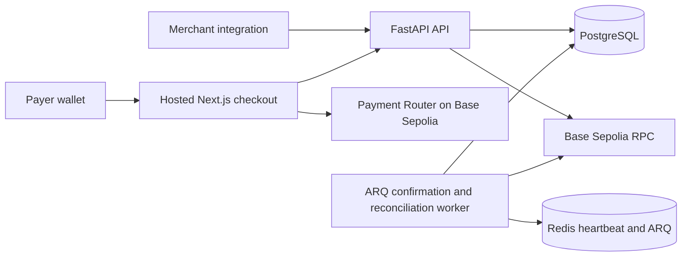

# Architecture

PayRail is a TypeScript web application, a Python FastAPI service, and an ARQ worker. PostgreSQL is the system of record; Redis supports ARQ operation and the worker heartbeat. Solidity contracts are maintained separately under Foundry. The TypeScript SDK is a future client package.

The API supports development merchant API keys, merchant-scoped payment intents, idempotency, and request-driven Base Sepolia receipt verification. Payment data uses integer base units and PostgreSQL via SQLAlchemy; SQLite is used for lightweight tests. The hosted checkout uses wagmi and viem with the existing Payment Router and depends on the API to verify mined receipts. The ARQ worker polls persisted payment intents and reconciles canonical receipts. There are no custody or settlement services.

